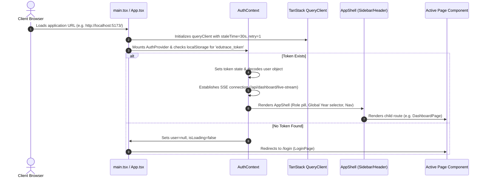
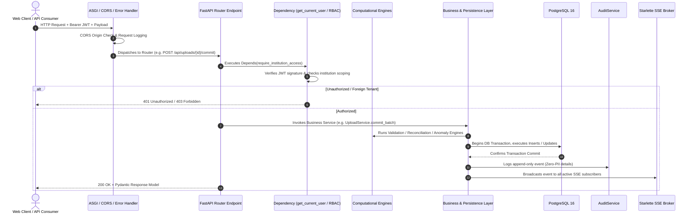
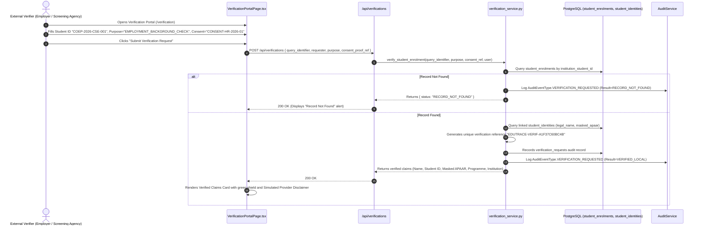
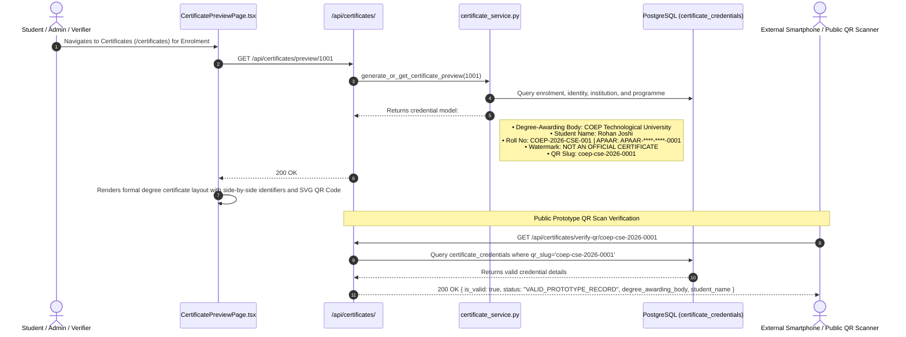
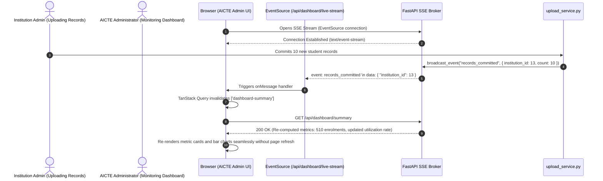

# EDUTrace — Complete End-to-End Solution Flow (Frontend, Backend & Combined)

**Problem Statement:** SIH26263  
**Project:** APAAR ID-Based Student Data Management and Verification Platform  
**Target Organization:** AICTE (All India Council for Technical Education)  
**Document Purpose:** Detailed technical flow of the entire solution across Frontend, Backend, and their integrated real-time interaction.  
**Document Version:** 1.0.0 (SIH 2026 Production-Grade Prototype)

---

## 1. High-Level System Architecture & Flow Map

```
┌────────────────────────────────────────────────────────────────────────────────────────┐
│                              FRONTEND FLOW (React 19 / Vite)                           │
│  UI Routing ──► AuthContext (JWT/Role) ──► TanStack Query Cache ──► Page View / Drawer │
│       ▲                                                                   │            │
│       │ SSE Event Listener (Re-fetch on commit/resolve)                    │ HTTP Calls │
└───────┼───────────────────────────────────────────────────────────────────┼────────────┘
        │                                                                   │
        │ JSON / Stream                                                     │ REST / Form
        ▼                                                                   ▼
┌────────────────────────────────────────────────────────────────────────────────────────┐
│                              BACKEND FLOW (FastAPI / ASGI)                             │
│  HTTP Request ──► CORS / Security ──► RBAC Tenant Filter ──► Engine Pipeline           │
│                                                                   │                    │
│                                                                   ▼                    │
│  SSE Event Broker ◄── Transaction Commit ◄── Business Services ◄── Relational DB (PG16)│
└────────────────────────────────────────────────────────────────────────────────────────┘
```

---

## 2. The Frontend Flow (Client-Side Lifecycle)

The frontend is built on **React 19**, **TypeScript**, **Vite**, **Tailwind CSS v4**, and **TanStack Query**.

### 2.1 Bootstrapping, State Initialization, and Routing


### 2.2 Client-Side Data Fetching & Cache Synchronization
1. **Declarative Queries:** All data fetching uses TanStack Query hooks keyed by query parameters:
   - `['dashboard-summary', selectedYearId, selectedInstId]`
   - `['enrolments', page, search, programmeId, status]`
   - `['issues', severity, status, institutionId]`
2. **Context Filtering:** The global `Header` component holds the active `AcademicYear` selector and `Institution` filter. When a user changes the dropdown, all dependent query keys automatically trigger background cache invalidation and UI re-renders without full-page reloads.
3. **Optimistic Updates & Mutation Handlers:** Actions (such as recording a reviewer decision or staging an upload) execute via `useMutation`. Upon successful backend resolution, query caches are invalidated, showing authoritative server state immediately.
4. **SSE Live Invalidation:** The `AuthContext` listens for Server-Sent Events (`records_committed`, `issue_resolved`, `eoa_confirmed`). When received, it automatically invalidates query caches, keeping charts and metric cards up to date across multi-user environments.

---

## 3. The Backend Flow (Server-Side Request Lifecycle)

The backend is built on **FastAPI**, **Pydantic v2**, **SQLAlchemy**, and **PostgreSQL 16**.

### 3.1 HTTP Request Interception & Processing Pipeline


### 3.2 Backend Isolation & Transactional Guarantees
1. **Dependency Injection:** Database sessions (`SessionLocal`) are managed via FastAPI's `Depends(get_db)`. Sessions are yielded per request and strictly closed upon request termination, preventing connection pool exhaustion.
2. **Transaction Atomicity:** Multi-record mutations (such as committing a 500-student batch) run within an explicit `with db.begin():` block. If any database constraint or invariant fails, the entire transaction rolls back, leaving no orphaned staging rows or partial enrolments.
3. **Zero-PII Invariant:** Identity strings are canonicalized and hashed via keyed HMAC-SHA256 (`backend/app/core/security.py`). The resulting `protected_identity_fingerprint` is used for all indexing, while presentation layers dynamically format the masked string `APAAR-****-****-XXXX`.
4. **Formula-Injection Defense:** In `ReportService`, string values in CSV exports are checked; any cell starting with `=`, `+`, `-`, `@`, `\t`, or `\r` is escaped with a leading single quote (`'`), neutralizing spreadsheet formula execution.

---

## 4. Combined End-to-End Integrated Flows

Below are the complete, step-by-step integrated flows demonstrating how the frontend and backend interact during the primary user journeys.

---

### Flow A: Authentication & Demo Persona Session Initialization

```mermaid
sequenceDiagram
    autonumber
    actor User as Reviewer / Admin
    participant UI as LoginPage.tsx
    participant AuthContext as AuthContext.tsx
    participant AuthAPI as /api/auth/login
    participant Security as core/security.py (Bcrypt)
    participant DB as PostgreSQL (users table)
    participant Audit as AuditService

    User->>UI: Clicks "Authorized Reviewer" Quick-Login
    UI->>UI: Sets email="reviewer@aicte.gov.in", password="Demo@2026"
    UI->>AuthAPI: POST /api/auth/login { email, password }
    AuthAPI->>DB: Query User by email
    DB-->>AuthAPI: Returns User entity (role='AUTHORIZED_REVIEWER', hashed_password)
    AuthAPI->>Security: verify_password("Demo@2026", hashed_password)
    Security-->>AuthAPI: True (Bcrypt match)
    AuthAPI->>Security: create_access_token({ sub: user.id, role: user.role })
    Security-->>AuthAPI: Returns signed JWT access token
    AuthAPI->>Audit: Log AuditEventType.AUTH_LOGIN (Outcome=SUCCESS)
    AuthAPI-->>UI: 200 OK { access_token, user: { role, full_name, email } }
    UI->>AuthContext: login(token, user)
    AuthContext->>AuthContext: Saves token in localStorage; connects SSE stream
    AuthContext-->>UI: Redirects to Command Dashboard ("/")
```

---

### Flow B: Official AICTE EoA Ingestion & Intake Baseline Registration

```mermaid
sequenceDiagram
    autonumber
    actor Admin as AICTE Administrator
    participant UI as ProgrammeApprovalsPage.tsx
    participant EoAAPI as /api/programmes/eoa-parse
    participant Parser as EoAParserService.py
    participant ConfirmAPI as /api/programmes/eoa-confirm
    participant DB as PostgreSQL (approval_intakes)
    participant SSE as SSE Broker

    Admin->>UI: Drops official AICTE EoA PDF / text document
    UI->>EoAAPI: POST /api/programmes/eoa-parse (multipart/form-data)
    EoAAPI->>Parser: parse_eoa_document(file_bytes)
    Parser->>Parser: Regex pattern extraction for EoA reference, AY, and programmes
    Parser-->>EoAAPI: Returns extracted reference, year, programmes, status="MACHINE_EXTRACTED"
    EoAAPI-->>UI: 200 OK (Displays extraction preview with confidence score)
    Admin->>UI: Reviews extracted intake values and clicks "Confirm EoA Baseline"
    UI->>ConfirmAPI: POST /api/programmes/eoa-confirm { reference_number, programmes, ay_id }
    ConfirmAPI->>DB: Saves source_document record (status="CONFIRMED")
    ConfirmAPI->>DB: Upserts approval_intakes (base_approved_intake, supernumerary, effective_limit)
    ConfirmAPI->>SSE: Broadcasts "eoa_confirmed" event
    ConfirmAPI-->>UI: 200 OK { status: "CONFIRMED", message: "Official intake baseline updated" }
    UI->>UI: Re-fetches programme approvals table; shows verified EoA badge
```

---

### Flow C: The 4-Stage Student Data Onboarding & Atomic Commit

This flow represents the core admission ingestion pipeline: **Scope Selection $\to$ Staging $\to$ Dry-Run Validation $\to$ Atomic Commit**.

```mermaid
sequenceDiagram
    autonumber
    actor Operator as Institution Data Operator
    participant UI as UploadWizardPage.tsx
    participant UploadAPI as /api/uploads/
    participant UploadService as upload_service.py
    participant Validator as DeterministicValidator.py
    participant Reconciler as AdmissionReconciler.py
    participant DB as PostgreSQL (identities, enrolments, issues)
    participant SSE as SSE Broker

    Note over Operator, UI: Stage 1 & 2: Scope & File Upload
    Operator->>UI: Selects COEP, AY 2026-27, CSE, Declared Total=10, uploads clean_sample.csv
    UI->>UploadAPI: POST /api/uploads/stage (multipart/form-data with scope & file)
    UploadAPI->>UploadService: stage_file(file_bytes, inst_id, ay_id, declared_count)
    UploadService->>DB: Creates upload_batch (status='STAGED') & inserts rows into upload_staging_rows
    UploadService-->>UploadAPI: Returns batch summary (id=13, row_count=10)
    UploadAPI-->>UI: 200 OK { batch_id: 13, status: "STAGED", total_rows: 10 }

    Note over Operator, UI: Stage 3: Dry-Run Validation (No Permanent Writes)
    Operator->>UI: Clicks "Run Dry-Run Validation"
    UI->>UploadAPI: POST /api/uploads/13/validate
    UploadAPI->>UploadService: validate_upload_batch(13)
    UploadService->>Validator: Validates 12-digit format readiness, required fields, duplicates
    UploadService->>Reconciler: Compares (staged_valid + existing_enrolled) vs effective_limit
    UploadService->>Reconciler: Compares declared_count vs staged_rows
    UploadService-->>UploadAPI: Returns dry-run report (valid=10, errors=0, intake impact)
    UploadAPI-->>UI: 200 OK { valid_count: 10, warning_count: 0, error_count: 0, duration_ms: 8.46 }
    UI->>UI: Displays row previews, error indicators, and intake reconciliation cards

    Note over Operator, UI: Stage 4: Explicit Confirmation & Atomic Commit
    Operator->>UI: Clicks "Confirm & Commit 10 Records"
    UI->>UploadAPI: POST /api/uploads/13/commit
    UploadAPI->>UploadService: commit_upload_batch(13)
    UploadService->>DB: Begins DB Transaction
    loop For each valid staging row
        UploadService->>UploadService: Computes keyed HMAC-SHA256 fingerprint & masked APAAR
        UploadService->>DB: Upserts student_identities
        UploadService->>DB: Inserts student_enrolments
    end
    alt Intake Exceeded Limit
        UploadService->>DB: Generates validation_issues (rule='INTAKE_CAPACITY_EXCEEDED')
    end
    UploadService->>DB: Updates upload_batch (status='COMMITTED')
    DB-->>UploadService: Transaction Committed
    UploadService->>SSE: Broadcasts "records_committed" event
    UploadService-->>UploadAPI: Returns { committed: 10, issues_generated: 1 }
    UploadAPI-->>UI: 200 OK
    UI->>UI: Displays Success Screen; redirects to Dashboard
```

---

### Flow D: Exception Discovery, Cross-Institutional Duplicate Detection, and Human Review Resolution

```mermaid
sequenceDiagram
    autonumber
    actor Reviewer as Authorized Reviewer
    participant UI as ExceptionsPage.tsx
    participant IssueAPI as /api/issues/
    participant ReviewService as review_service.py
    participant DupDetector as DuplicateDetector.py
    participant DB as PostgreSQL (validation_issues, review_decisions)
    participant SSE as SSE Broker

    Note over DupDetector, DB: Background / Ingestion Duplicate Discovery
    DupDetector->>DB: Scans student_identities linked to multiple active enrolments in same AY
    DupDetector->>DB: Creates duplicate_candidate_groups & flags issue CROSS_INSTITUTION_DUPLICATE_CANDIDATE

    Note over Reviewer, UI: Reviewer Queue & Evidence Inspection
    Reviewer->>UI: Opens Exceptions Queue (/issues)
    UI->>IssueAPI: GET /api/issues?status=OPEN
    IssueAPI->>DB: Query validation_issues where status='OPEN'
    DB-->>IssueAPI: Returns list of issues (Intake exceeded, Duplicates, Format readiness)
    IssueAPI-->>UI: 200 OK
    Reviewer->>UI: Clicks issue #25 (INTAKE_CAPACITY_EXCEEDED)
    UI->>UI: Opens Detail Drawer displaying:
    Note right of UI: Base: 120 | Supernumerary: 18 | Effective: 138 | Calculated: 140 | Excess: 2

    Note over Reviewer, UI: Action Recording & Resolution
    Reviewer->>UI: Selects action "REQUEST_CORRECTION", enters notes, and clicks Submit
    UI->>IssueAPI: POST /api/issues/25/decision { action: "REQUEST_CORRECTION", reason: "Excess 2 admissions" }
    IssueAPI->>ReviewService: record_decision(25, action, reason, user)
    ReviewService->>DB: Inserts review_decisions record with timestamp, actor_id, notes
    ReviewService->>DB: Updates validation_issues status='CORRECTION_REQUESTED'
    ReviewService->>SSE: Broadcasts "issue_resolved" event
    ReviewService-->>IssueAPI: Returns { status: "SUCCESS", new_status: "CORRECTION_REQUESTED" }
    IssueAPI-->>UI: 200 OK
    UI->>UI: Updates issue status badge in drawer and table; shows success toast
```

---

### Flow E: Purpose-Bound Third-Party Identity Verification



---

### Flow F: Degree Credential Issuance, Certificate Preview & Public QR Code Route



---

### Flow G: Real-Time SSE Notification & Live Dashboard Re-computation



---

## 5. Security, Invariant Assertions & Error Handling

### 5.1 System Invariant Checks
1. **Intake Immutability during Enrolment:** Approved intake values are read-only metadata during student uploads; no student import can alter sanctioned capacity limits.
2. **Zero Plaintext Identity Storage:** Plaintext 12-digit APAAR references exist in memory only during the dry-run validation stage. Once committed, only the HMAC-SHA256 fingerprint and display mask persist.
3. **Non-Adverse Candidate Matching:** Duplicate candidates detected across institutions remain flagged as pending review; admissions are **never** cancelled automatically.
4. **Append-Only Auditing:** The `audit_events` table contains no update or delete controller endpoints, maintaining an immutable historical log of all application actions.

### 5.2 Error Propagation Table

| Failure Scenario | Trigger Point | Backend Status & Handling | Frontend UX Response |
| :--- | :--- | :--- | :--- |
| **Malformed Token or Expired Session** | Any protected endpoint | `401 Unauthorized` with detail `"Token expired or invalid"` | Clears `localStorage`, redirects user to `/login` with an informational banner. |
| **Cross-Tenant Resource Access Attempt** | Institution user requests foreign ID | `403 Forbidden` via `enforce_institution_scope` | Displays an access denied notification; prevents data rendering. |
| **Invalid CSV Header or Missing File** | `/api/uploads/stage` | `400 Bad Request` with exact missing column list | Form remains on step 2; displays red error alert with required column headers. |
| **APAAR Format Readiness Failure** | `/api/uploads/{id}/validate` | Flagged in dry-run preview as `INVALID` with `APAAR_FORMAT_READINESS` | Rows are highlighted red in dry-run preview with explanatory tooltip. |
| **Formula Injection Attempt in Export** | `/api/reports/reconciliation/export-csv` | Value sanitized with leading single quote (`'`) | File downloads cleanly; spreadsheet software treats cell as plain text. |
